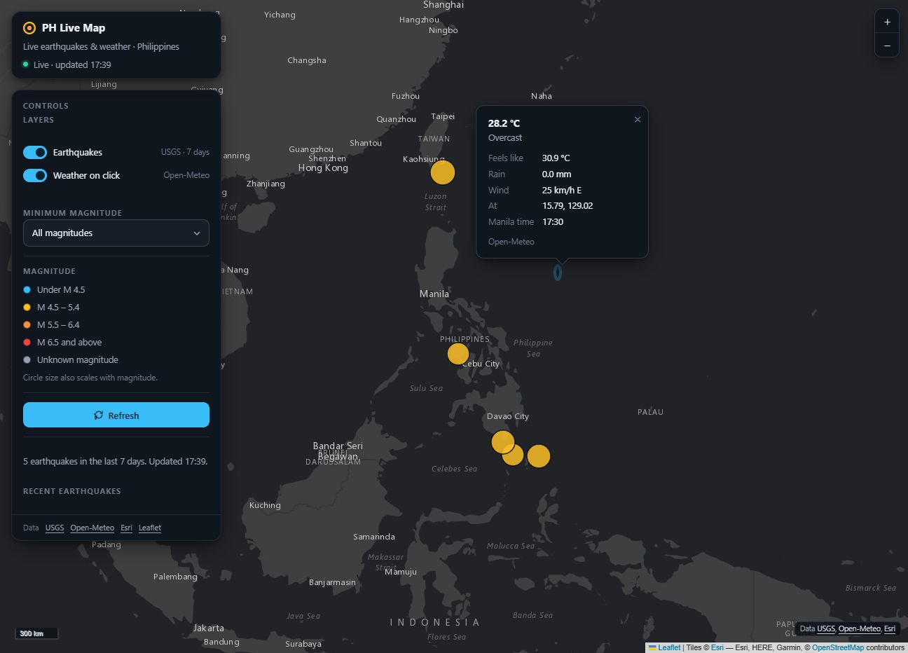
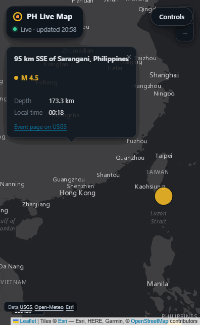

# PH Live Map

A small, fast dashboard that shows live earthquakes and click-anywhere weather on a dark map of the Philippines. It is plain JavaScript and Vite on top of Leaflet, with no backend, no accounts, and no API keys. Every state the network can put it in — loading, stale, empty, offline — is shown honestly in the UI.





**Live demo:** https://arcogm.github.io/ph-live-map/

## Features

- **Earthquakes** — the last 7 days of USGS events inside a bounding box around the Philippines (lat 4–22, lon 116–128), drawn as circles sized and colored by magnitude.
- **Quake popups** — place, magnitude, depth, and local time in Asia/Manila.
- **Weather on click** — current temperature, feels-like, rain, wind speed and direction, and coordinates for any point you click (Open-Meteo).
- **Honest freshness** — data is cached for five minutes; the brand shows Live / Updating / Stale / Offline, and the app keeps the last good data when a refresh fails.
- **Layer toggles and a magnitude filter** — All / 4.5+ / 5.5+ / 6.5+, plus a legend and a recent-earthquakes list.
- **Responsive and keyboard friendly** — the control panel collapses to a sheet on phones, and every control (including the quake list that opens popups) is reachable by keyboard.

## Run it locally

```sh
npm install
npm run dev        # http://localhost:5173/
```

Build and preview the production bundle:

```sh
npm run build
npm run preview
```

Run the tests (pure logic, no network):

```sh
npm test
```

## Deploy

Pushing to `main` deploys `dist/` to GitHub Pages through `.github/workflows/deploy.yml`. Vite sets `base` to `/ph-live-map/` only in CI; local dev stays at `/`. To host under a different path, change that one line in `vite.config.js`.

## Data sources and credits

| Source | Used for | Terms |
| --- | --- | --- |
| [USGS Earthquake Catalog](https://earthquake.usgs.gov/fdsnws/event/1/) | Earthquake layer | Public domain, no key |
| [Open-Meteo](https://open-meteo.com/) | Weather on click | Free for non-commercial use, no key |
| [Esri Dark Gray Canvas](https://www.esri.com/) | Dark basemap and labels | Tiles © Esri — Esri, HERE, Garmin, © OpenStreetMap contributors |
| [Leaflet](https://leafletjs.com/) | Map library | BSD-2-Clause |

USGS is used instead of PHIVOLCS because PHIVOLCS has no clean public API that can be confirmed; the catalogue is global and filtered to the Philippine bounding box. Please keep the attribution in the footer and here if you fork this.

The design doc originally chose CARTO dark tiles. When building, CARTO began watermarking keyless tiles with "API KEY REQUIRED", so the basemap moved to Esri's keyless Dark Gray Canvas (verified 2026-11-27). The switch is two tile URLs in `src/main.js`.

## How it is put together

- `index.html` — page shell, map container, control panel, credits.
- `src/main.js` — map setup, tile layers, click routing, load and refresh state.
- `src/layers/earthquakes.js` — USGS fetch, quake model, and Leaflet layer.
- `src/layers/weather.js` — Open-Meteo fetch, click pin, and weather popup.
- `src/ui/panel.js` — toggles, magnitude filter, legend, quake list, status messages.
- `src/ui/freshness.js` — the five-minute staleness check and silent background refresh.
- `src/utils/cache.js` — tiny in-memory TTL cache with an injectable clock.
- `src/ui/format.js` — pure formatting helpers (Manila time, depth, compass, bins).

To rebuild `docs/demo.gif` from frame PNGs: `node tools/make-demo-gif.mjs a.png b.png c.png` (no ffmpeg needed).

## Accessibility notes

All chrome is ordinary buttons, checkboxes, and selects, so focus and activation come from the browser. Status changes are announced through an `aria-live="polite"` region, and the spinner respects `prefers-reduced-motion`. Earthquake popups can be opened from the keyboard through the labelled quake list in the panel. **Weather is click-only**: picking a point with a non-pointer control is new UI the spec did not ask for, so it is a documented limitation rather than a hidden trap.

## What I learned

- Designing failure states first made the happy path simpler: one status object drives the brand, the panel, and the map card, so "offline" never means a blank map.
- A five-minute cache plus visibility checks is enough to feel live without hammering a free API; the interesting part was deciding when data is stale versus merely old.
- Free tile providers change their terms without notice. Checking the actual tiles in a browser, not just the docs, caught CARTO's new watermark before it shipped.
- Splitting pure fetch/format logic from Leaflet view code made the whole data layer testable with `node:test` and no DOM.
